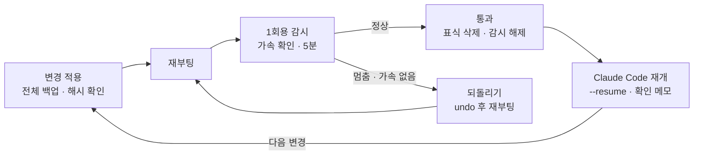

# macOS on Lenovo IdeaPad 5 Pro

레노버 노트북(i5-1135G7, Intel Iris Xe + GeForce MX450)에 macOS Tahoe를 올려 켜지는 데서 그치지 않고 매일 쓰는 맥북처럼 정착시킨 기록입니다. 그래픽 드라이버·부팅 설정·ACPI 수준의 수정은 Claude Code와 함께 했습니다. Claude Code가 실패해도 시스템이 스스로 되돌아오도록 만든 작업 환경도 담았습니다.

- 기간: 2026.11.11 ~ 11.17 (Claude Code 세션 48개)
- 부트로더: OpenCore / 그래픽: [WhateverXe](https://github.com/b00t0x/WhateverXe)(Lilu 플러그인) 수정본 / 외장 GPU: NullMoth NVIDIA 드라이버 수정본

## 정착 결과

Apple 보안 칩이 꼭 있어야 하는 기능(iPhone 미러링, Touch ID, Apple Pay)을 빼면 맥북에서 쓰던 기능을 그대로 씁니다.

- 그래픽 가속(Metal)과 외장 그래픽카드(MX450), 고해상도(HiDPI) 화면과 밝기 조절
- Wi-Fi, 블루투스, AirDrop
- 스피커·이어폰·마이크, 트랙패드, 한영 전환, 제어 센터와 연동되는 키보드 백라이트
- 카메라, Safari YouTube 하드웨어 영상 재생(VP9 포함), 런치패드
- 배터리 잔량과 남은 시간 표시, 충전 80% 제한

| 항목 | 개선 전 | 개선 후 |
|---|---|---|
| CPU 패키지 유휴 전력 | 9.5W | 3.2W |
| 내장 그래픽 유휴 전력 | 5.3W | 0.08W |
| 화면 켬 유휴 전력 (MX450 전원 차단) | 14W | 8.3W |
| 부팅 시간 | 54초 | 17초 |
| 화면 끔 상태 트랙패드 깨움 | 초당 807회 | 0회 |

## 스스로 복구되는 작업 환경

드라이버나 부팅 설정을 바꾸는 변경은 모두 `apply | undo | check` 스크립트로 만들고 다음 부팅 때 한 번만 도는 감시가 결과를 판정합니다.

- 화면이 멈춰 강제 종료되면 그 부팅의 감시는 판단하지 못합니다. 그래서 다음 부팅에서 지워지지 않은 표식이 남아 있으면 실패로 보고 되돌립니다.
- 재부팅 뒤에는 지정한 Claude Code 세션이 스스로 다시 열리고 재부팅 전에 남긴 확인 메모를 첫 메시지로 받습니다.
- 사용 중이면 재부팅을 거부하는 `safe-reboot.sh`, GPU를 멈추게 한 벤치마크 명령만 실행 직전에 막는 PreToolUse 훅, 작업 완료 알림을 함께 씁니다.

## 주요 문제와 해결

| 증상 | 원인 | 해결 |
|---|---|---|
| 화면 전체가 멈추고 강제 종료 | 화면 찢김 방지용 주사선 대기 명령(`WAIT_ON_SCANLINE`)이 이 기기에서는 끝나지 않음. GPU 오류 보고서 20건의 공통점으로 확정 | WhateverXe 패치 `-wex-noscansync` |
| WindowServer 메모리가 12GB까지 증가 | Intel Metal 드라이버의 해제 누락 | 서명된 드라이버 파일은 그대로 두고 메모리만 고치도록 Lilu 사용자 영역 패처를 다시 구현 |
| YouTube VP9이 CPU로만 재생 | Apple의 Tiger Lake 영상 드라이버에 VP9 디코더가 없음 | Intel 공개 미디어 드라이버의 디코더를 이식, Safari 1080p60 하드웨어 재생 |
| 외장 GPU가 쓰지 않을 때도 켜져 있음 | macOS ACPI가 점 없는 4글자 이름만 호출 | SSDT로 `XPOF`/`XPON`을 만들어 드라이버가 부르게 함 |
| 충전 중 소비 전력 14W | 다른 스크립트가 부팅 인자를 다시 쓰며 `\` 한 글자를 지움 | 부팅 설정 백업을 시간순으로 비교해 찾고 복구 |
| 강제 종료 뒤 진단 기록이 사라짐 | NVRAM 즉시 기록이 특정 호출 경로에서만 동작 | 커널 소스와 역어셈블로 경로를 확인하고 기록 방식 수정 |
| 이어폰 울림·보컬 빠짐 | 콤보잭 접지 방식(CTIA) 미설정 | 코덱 계수 설정, 꽂을 때 소리는 Linux 드라이버의 대기 절차를 이식 |

Apple 그래픽 드라이버는 소스가 공개되지 않아 Claude Code에 리버스 엔지니어링 플러그인([rea](https://github.com/morluto/rea))을 붙여 macOS 설치 이미지에서 드라이버를 꺼내 분석한 자료를 근거로 삼았습니다. 분석 결과물(Apple 바이너리)은 저작권 때문에 이 저장소에 넣지 않았습니다.

## 폴더

| 폴더 | 내용 |
|---|---|
| `driver-patches/` | WhateverXe 0.8.0 / 0.8.2 원본 대비 수정 diff, Lilu 사용자 영역 패처 diff, NVIDIA 프레임버퍼 수정 diff와 빌드 스크립트 |
| `acpi/` | 외장 GPU 전원 차단용 SSDT 소스 |
| `scripts/steps/` | 변경마다 만든 적용·되돌리기·확인(`apply`·`undo`·`check`) 스크립트와 1회용 감시 |
| `scripts/system/` | 충전 제한, MX450 사용 앱 정책, HiDPI, 한영키, 뚜껑 닫으면 종료 등 상주 설정 |
| `scripts/wex-0.8.2/` | WhateverXe 0.8.2 이식본 설치·되돌리기 스크립트 |
| `apps/` | 직접 만든 앱: 음악 플레이어 Sona(SwiftUI·AVAudioEngine), Claude 사용량 메뉴 막대, MX450 관리, 이어폰 보정 |
| `claude-code-env/` | Claude Code 훅(GPU 벤치마크 차단, 알림), 사용량 상태 표시줄, 재부팅 뒤 자동 재개, `safe-reboot.sh`, Recovery 안에서 `claude`를 실행하는 복구 USB 구성 |

## 주의

- 이 저장소에는 직접 작성한 스크립트·문서와 원본 대비 수정 diff만 있습니다. Apple 소프트웨어, 다른 프로젝트의 바이너리, 기기 일련번호가 든 EFI 설정은 넣지 않았습니다.
- 스크립트의 경로·장치 ID·레지스터 값은 이 기기 기준입니다. 다른 기기에서 그대로 실행하지 마세요.
- macOS 사용권 계약은 Apple 하드웨어에서 사용하는 것을 전제로 합니다. 이 기록은 학습과 문제 해결 과정 공유를 위한 것입니다.
- 원본 프로젝트의 라이선스를 따릅니다: WhateverXe·Lilu(BSD-3-Clause), NVIDIA 드라이버 수정분(원 프로젝트 라이선스).
